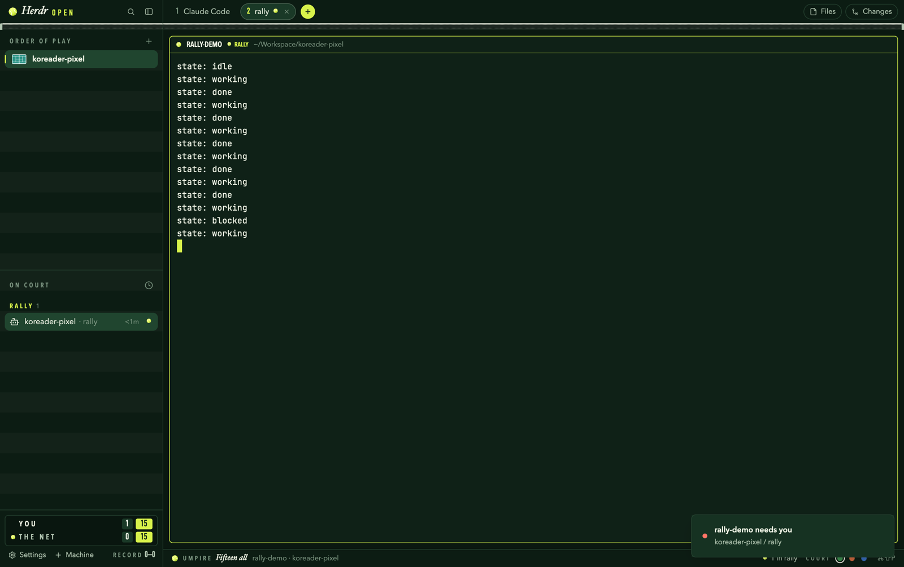

# Herdr Open

A tennis stadium for your agents. The window sits on a court (grass, clay or
hard, switched with one click), a net runs across the top under the tab bar,
spaces are courts on the order of play, agents are on court, and a scoreboard
keeps a real tennis match between **You** and **the Net**: every agent that
finishes wins you a point, every agent that gets stuck gives one to the Net.
An umpire calls each point in the status bar.

## What you see

Left to right: a 272px sidebar, then the work column.

- **Sidebar head (50px).** A full-color tennis ball (15px), "Herdr" in Hoefler
  Text italic 19px, "OPEN" in DIN Condensed Bold 14px, letter-spaced with hair
  spaces, in ball yellow `#d8f24b`. Find and fold buttons on the right. On
  macOS it leaves 84px for the traffic lights (`[14, 14]`). The net's left
  post sits at its bottom edge.
- **Order of play (spaces).** Header "ORDER OF PLAY" in Avenir Next Condensed
  Demi 11px, letter-spaced. Each space has a 24×16 court drawn from above: its
  surface color (`#2a9486` teal, `#c8643c` clay, `#3468b4` blue, `#6b55ad`
  carpet, `#3a8a4c` grass, `#b5475e` red, picked from the stored
  `space.colors` names), chalk doubles lines, faint singles, service and
  centre lines, and a bright net down the middle. The shown space gets a
  selected background and a 2px ball-yellow bar on its left edge.
- **On court (agents).** Header "ON COURT". Sections in priority view are
  "YOUR SERVE", "GAME", "RALLY", "CHANGEOVER". Each row has two lines: the
  session (named tab, or the agent's title) on top, the workspace below in
  11.5px dim text. Under a space header (grouped view) the second line is the
  program instead.
- **Scoreboard (96px sidebar foot).** A dark score bug with two rows, "YOU"
  and "THE NET" (condensed capitals). Each row shows a small ball beside
  whoever is serving, completed set scores (DIN Condensed, winner bright,
  loser dim), current games on a raised box, and the point (0, 15, 30, 40,
  AD, or tiebreak numbers) on a ball-yellow box. Below it are Settings,
  Machine and RECORD w–l (matches won and lost).
- **Tab bar (50px).** Pill tabs (28px tall, radius 14), each with a DIN
  Condensed number (ball yellow when shown; it's the cmd-<n> key), the name,
  and its ball. The shown tab is raised with a faint chalk outline and a
  close ×. A round ball-yellow + opens the new menu. Files and Changes are
  outlined pills that fill with a yellow tint when open. Under everything is
  **the net**: 2px chalk tape, a 7px checkerboard mesh, a faint bottom cord,
  and a 4×11 post at the far right.
- **Panes.** Cards with radius 6, gap 10, a chalk border at 14% alpha, and a
  ball-yellow border on focus. Each 28px header is a player's name strip: a
  ball beside the focused pane (on serve) or an empty ring, then the program
  in condensed capitals, its state (RALLY with a bouncing ball, or a YOUR
  SERVE / GAME pill), and the folder. Split, zoom and close appear on hover.
- **Status bar (30px).** A ball, "UMPIRE", the last call in Hoefler Text
  italic ("Love all. Play.", "Thirty–Fifteen", "Deuce", "Game and first set,
  You") with who earned it, then the counts in rally and on your serve, the
  branch, "COURT" with three surface swatches (the current one ringed in
  chalk), and the palette key.
- **Surfaces.** Three themes, each with ANSI colors tuned to its court, the
  same ball-yellow accent, and a ball-yellow cursor:
  - Grass: `#0f2117`, with mowing stripes in the sidebar
  - Clay: `#2a1711`, with a faint brushed drag
  - Hard: `#0e1d33`, with nothing

## How it behaves

- **Working** = Rally: a ball bounces in place (native `loop("top")`, eased
  in so it speeds into the ground). **Blocked** = Your serve: a coral ball
  and a pill. **Done** = Game: a ball in the theme's done color (lavender,
  sky or mint). **Idle** = Changeover: an empty outline.
- **The match.** An agent going from working to done or idle scores for
  You. An agent going into blocked scores for the Net. The scoring is real
  tennis: 15/30/40, deuce and advantage, six games a set, a tiebreak at six
  all (first to 7, by 2), best of three sets. The serve changes every game.
  Set and match wins post a toast. After a match, the next point starts a
  new one and the record keeps count. The match is kept in shared state
  `herdr-open.match`, so it survives restarts. Double-click the scoreboard
  for a new match. The first run starts at love all.
- **Clicks.** Click a COURT swatch to run `app.theme` with that surface's
  theme. Click or drag tabs to select or reorder them. Double-click a tab to
  rename it. Right-click a tab for its menu. Scroll over the tab bar to step
  through tabs. Spaces and agents keep every behavior of Herdr's shipped
  lists: drag to reorder, menus, pins, sorting, worktrees, machines.
- **Sounds (optional).** `mods/herdr-open/sounds/done.mp3` is a racquet pock
  and a bounce. `blocked.mp3` is a two-beep electronic fault call. To use
  them, set them in settings.json under `sounds.done` / `sounds.blocked`.

## Built from

- `layouts/herdr-open.json`: root row (titlebar none, theme
  `herdr-open-grass`, ui_font Avenir Next, terminal padding [12, 10]).
  - The sidebar column holds `brand`, `spaces`, `agents` and
    `sidebar-footer`.
  - The work column holds `tabs`, then `work-body` (the `main` tab block plus
    the hidden `panel` / `panel-body` stack with `files` and `changes`), then
    `status`.
- `mods/herdr-open`: one mod, several parts chosen by `props.part`: `brand`,
  `tabs`, `score`, `status`. Pane headers get `{pane, terminal}`.
  - `kit.js` holds the shared balls, net (`window.paint_path` with
    `Background.checkerboard`), lettering, surfaces and tennis words.
  - `match.js` is the scoring.
- `mods/herdr-open-spaces` and `mods/herdr-open-agents`: clones of Herdr's
  shipped `spaces` and `agents` (Apache-2.0, credited at the top of each
  file), restyled.
- Herdr calls used: `agents`, `spaces`, `panes`, `shared`/`setShared`,
  `notify`, `run`, and the commands `app.theme`, `layout.show`/`hide`/
  `select`/`resize`, `tab.*`, `pane.*`, `mod.open`, `app.settings`,
  `app.palette`.
- No network, no `exec` beyond what the shipped spaces mod already does
  (git status).
- Art: `ball.svg` (full-color felt with seams), `ball-glyph.svg` (one color,
  seams masked out, for tinting), `plus.svg`.

## Watch out

- Fonts are macOS ones: Hoefler Text, DIN Condensed, Avenir Next and Avenir
  Next Condensed. Elsewhere they fall back.
- Surface detection compares `theme().background` with the three
  backgrounds. A theme picked from elsewhere shows no ring and no texture.
- The scoreboard part is the only copy that keeps score. It also checks
  every 1.5s, so it still counts while hidden. It only scores while this
  layout is shown, and its first look after loading never scores.
- `texture()` must return an element, never null: `child(null)` throws.
- In the cloned lists, herdr's `window` import shadows the global
  `window.paint_path`. It is imported as `appWindow` instead.
- `herdr-app check` renders the main mod with no props, so it doesn't test
  the parts. Look at them in the app.

## Done when

- `herdr-app check` passes for all three mods and `herdr-app status` shows
  no errors.
- `layout.switch {name: "herdr-open"}` shows the net running across the
  sidebar head and the tab bar, with a post at each end.
- Clicking each COURT swatch recolors the whole window and moves the ring.
- An agent that finishes moves You's point (0→15). One that blocks moves
  the Net's. Deuce, advantage, a 6–6 tiebreak and a best-of-three match all
  score correctly, and the umpire line matches.
- Agent rows show the session on one line and the workspace under it.
